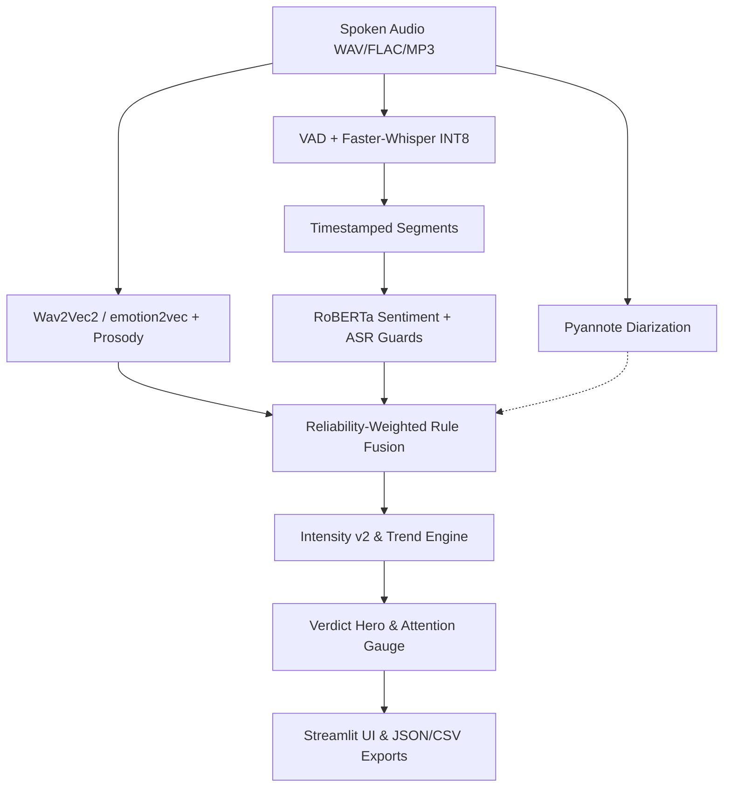

# Multimodal Voice & Conversation Emotion Analysis System

Academic research prototype analyzing spoken dialogue across acoustic prosody and linguistic semantics via transparent rule-based fusion. **Strict Scope**: does **NOT** detect sarcasm, deception, lies, or psychological intent; strictly **NOT** for clinical, hiring, surveillance, or risk assessment.



## Models & Formulation

| Model ID | Pipeline Stage | Purpose | Licence |
|---|---|---|---|
| `superb/wav2vec2-base-superb-er` | Voice Emotion | 4-class acoustic emotion (runtime fallback) | Apache-2.0 |
| `emotion2vec/emotion2vec_plus_base` | Voice Emotion | Config default (`VOICE_BACKEND`, needs funasr) | Apache-2.0 |
| `openai/whisper-base` | Speech-to-Text | VAD & CTranslate2 INT8 CPU transcription | MIT |
| `cardiffnlp/twitter-roberta-base-sentiment-latest` | Text Sentiment | 3-class transcript sentiment | Apache-2.0 |
| `pyannote/speaker-diarization-community-1` | Diarization | Speaker separation (optional, gated HF token) | MIT / Gated |

- **Voice Backend & Confidence Cap**: `config.VOICE_BACKEND` defaults to `emotion2vec` with `superb` fallback. `VOICE_CONF_CAP = 0.65` mitigates softmax saturation on out-of-domain audio.
- **Fusion Rules (`app/fusion.py`)**: `agreement_negative_high_arousal`, `agreement_negative_low_arousal`, `agreement_positive`, `agreement_neutral`, `mismatch_positive_text_negative_voice`, `mismatch_negative_text_positive_voice`, `mismatch_generic`, `weak_disagreement`, `voice_only_text_unavailable`, `abstention_low_reliability` ($r_{\text{combined}} < 0.35$).
- **Intensity v2**: $I = 0.50 \cdot A_{\text{audio}} + 0.50 \cdot \text{negativity}_{\text{text}}$ ($I = A_{\text{audio}}$ on voice-only turns).
- **Attention Score (Gauge)**: $S = \min(100, 20 \cdot N_{\text{mismatch}} + 30 \cdot \mathbf{1}_{\text{escalation}} + 25 \cdot \max(0, \Delta I))$. Advisory review triage metric.

## Empirical Benchmark Results

Full reports: [crema_d_benchmark.md](evaluation/results/crema_d_benchmark.md), [latency.md](evaluation/results/latency.md), [ERROR_ANALYSIS.md](docs/ERROR_ANALYSIS.md), [robustness.md](evaluation/results/robustness.md), [calibration.json](evaluation/results/calibration.json).

| Benchmark / Corpus | Condition / Head | N | Accuracy / UAR (95% CI) | Status & Protocol Notes |
|---|---|---|---|---|
| **Self-Recorded Dev** | `superb` (sanity on) | 8 | Acc: 37.5% (Wilson CI: 13.7%–69.4%) | preliminary: self-recorded clips labelled by recording intent, not independent annotators |
| **Self-Recorded Dev** | `emotion2vec` (sanity on)| 8 | Acc: 62.5% (Wilson CI: 30.6%–86.3%) | preliminary: self-recorded clips labelled by recording intent, not independent annotators |
| **CREMA-D Dev CV** | Candidate Head (frozen emb)| 0 | Dev UAR did not beat baseline by $\ge 0.03$ | Candidate head rejected on dev; frozen decision: head not adopted |
| **CREMA-D Test Split**| `superb` baseline | 0 | not yet measured (clips missing on disk) | acted speech, actor-disjoint test split, N clips from N actors, cluster-bootstrap 95% CI; not natural speech |
| **Natural Set** | Independent consensus | 0 | not yet measured (tooling ready) | preliminary; protocol specified in [NATURAL_SET_PROTOCOL.md](docs/NATURAL_SET_PROTOCOL.md) |
| **Synthetic Noise** | White noise / 8 kHz | 0 | not yet measured (tooling SNR $\le 0.5$ dB) | synthetic noise; multi-condition benchmark deferred |

- **Datasets**: CREMA-D (ODbL, Cao et al., 2014); RAVDESS (CC BY-NC-SA 4.0, **not done**).

## Operational Limitations

1. **Tiny Self-Recorded Corpus**: Initial validation used $N=8$ self-recorded clips; acted corpora do not reflect natural-speech variance.
2. **Sanity Rule Scope**: Heuristic sanity gating is calibrated strictly to SUPERB Wav2Vec2 logits and must not run on emotion2vec.
3. **Softmax Saturation**: emotion2vec confidence saturates ($\ge 0.998$ on both correct and wrong turns); `VOICE_CONF_CAP` is an empirical heuristic and raw confidence is not a validity signal.
4. **Calibration Invariance**: Temperature scaling aligns ECE/NLL but strictly preserves argmax decisions and classification accuracy.
5. **Acoustic Preprocessing**: Prosody is normalized per recording; turns $< 1.0\text{s}$ (`VOICE_MIN_SEGMENT_SEC`) are excluded from trend OLS.
6. **Linguistic Scope**: Text sentiment is English-only (non-English audio defaults to voice-only analysis).
7. **Diarization & Edge Cases**: Pyannote requires gated HF token acceptance. Neutral vs. polar turns trigger mismatch flags; sad speech may predict neutral due to acoustic overlap. Bilingual emotion2vec raw labels render only the English token in UI.

## How to Run & Verify

```powershell
# 1. Install & configure environment
python -m venv .venv && .\.venv\Scripts\Activate.ps1
pip install -r requirements.txt
# Note: emotion2vec voice backend requires 'funasr' and 'torch'.
# (Optional) set HF_TOKEN in environment or .env for Pyannote speaker diarization

# 2. Run test suite & Streamlit app
python -m pytest tests -q
python -m streamlit run streamlit_app.py
```
*Note on Voice Backends:* If `funasr` is missing or `emotion2vec` cannot load, the system automatically falls back to `superb` (`Wav2Vec2`), and a clear fallback banner appears at the top of the results page detailing the configured backend, active fallback backend, and reason.
*(No synthetic DEMO_MODE exists in code; use the pre-recorded video capture if live CPU execution is not feasible).*

## Future Work, Privacy & Ethics

Future extensions include RAVDESS cross-corpus benchmarking, synthetic noise stress testing, multilingual expansion (Hindi/Telugu with validated sets), multi-rater consensus annotation, larger natural-speech corpora, transparent explainability tables, streaming WebSocket analysis, and containerized Docker deployments. See [PRIVACY_AND_ETHICS.md](docs/PRIVACY_AND_ETHICS.md) for data governance: 100% local CPU execution, 0 outbound network calls, ephemeral buffer deletion, and strict prohibitions against clinical or employment use.
